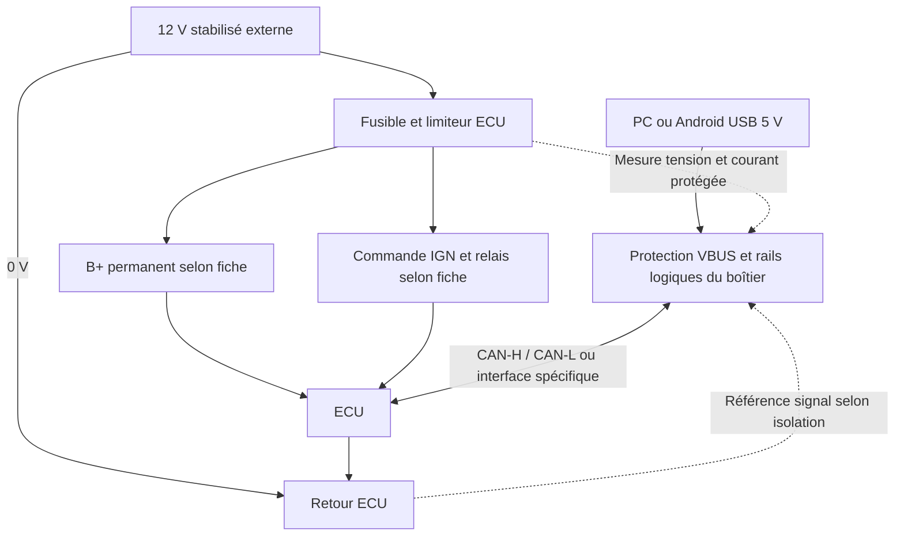

# Guide générique de raccordement — Rev A0, 22/11/2026

**Avant-projet : aucun faisceau véhicule/ECU ni pilote physique qualifié.** Ne pas connecter le prototype actuel à une cible. Les tableaux de ce dossier sont des références de préparation ; seules les fiches validées sur banc pour la référence matérielle exacte pourront autoriser un raccordement.

## Alimentation principale
USB-C/OTG 5 V depuis Android ou PC, sous réserve du courant disponible négocié/annoncé. Protection VBUS, limitation de courant et absence de retour vers l'hôte ; convertisseurs 3,3 V internes. Alimentation externe 12 V stabilisée (p. ex. 50 A disponibles) dédiée à la cible BENCH, pas au rail USB. Fusible près de la source, adapté au câble et au calculateur, limitation de courant séparée, mesure au connecteur ECU, protection inversion et surtension. Ne jamais mettre 50 A directement sur un petit faisceau. Le 12 V du DLC peut servir au SWCAN et à une alimentation auxiliaire protégée si nécessaire. Pour une opération critique, fournir une alimentation logique maintenue indépendante de la liaison de données, avec sélection de source sans retour VBUS, dimensionnée et testée ; aucun flash sur USB seul sans preuve de continuité. Wi-Fi/BLE sans USB nécessite une source locale. Aucun montage 12 V sur GPIO ou mémoire.

Le retour 0 V ne doit jamais être relié au +12 V ou à la sortie positive du fusible. Masse de référence selon conception de l'interface, isolation et topologie ; terre secteur conforme à l'alimentation, pas de modification secteur. Pas de source externe en parallèle de la batterie.

## Broches et modes
| Mode | Alimentation cible | Signaux externes |
|---|---|---|
| OBD-II | Batterie véhicule | DLC 4 masse châssis, 5 masse signal, 6 CAN-H, 14 CAN-L, 16 B+ pour mesure/auxiliaire protégé, 1 GM SWCAN si présent |
| CAN direct | Véhicule ou source externe | CAN-H, CAN-L, référence signal ; paire torsadée, terminaison adaptée |
| BENCH | B+, IGN, relais éventuels, retours distincts selon fiche | CAN-H/L ou SWCAN ; faisceau détrompé |
| BOOT/BAM | Selon fiche | BOOT, RESET, communication selon MCU ; aucun numéro générique |
| BDM | Selon fiche | Signaux spécifiques à l'architecture, Vref, GND |
| JTAG/Nexus | Selon fiche | TCK, TMS, TDI, TDO, Vref, GND ; resets/auxiliaires selon cible |
| SWD | Selon fiche | SWDIO, SWCLK, Vref, GND ; RESET si prévu |
| EEPROM ISP | Une seule source qualifiée | I2C SDA/SCL, SPI CS/SCK/MOSI/MISO, Microwire CS/SK/DI/DO selon référence ; isoler le contrôleur hôte |
| CHIP-OFF | VCC régulée et limitée du boîtier selon datasheet | Adaptateur ZIF/SOIC et protocole exact |

Les signaux nommés ne sont pas des broches physiques universelles. Ne pas connecter les broches réservées, notamment les entrées/sorties 5 V capteurs et low reference, comme masses de puissance. CAN : ne pas ajouter une résistance 120 ohms systématiquement sur véhicule ; vérifier terminaison hors tension sur banc. Voir [interconnexion Rev A](../../../hardware/rev-a-interconnect.md) et [prototype interne](../../../hardware/rev-a0-bench.md) pour les GPIO candidats.

## Contrôles utilisateur avant alimentation
1. Identifier référence GM et HW, millésime, moteur/RPO, photos et repères connecteurs, vue face contacts/côté fils ; valider fiche exacte et continuité hors tension.
2. Contrôler la polarité, tension au connecteur, limitations, fusible et comportement sous charge ; ne pas appliquer 12 V sur un signal ou Vref.
3. N'alimenter que les broches et dans l'ordre constructeur ; sélectionner route et interface exactes. Aucun pontage improvisé.
4. Avant écriture : double lecture, sauvegarde/restauration qualifiée, image conforme OEM, tension stable, plan vérifié, lien authentifié, alimentation maintenue et recovery disponible. Pas de coupure/reset automatique pendant un cycle critique. Aucune signature supplémentaire dans les fichiers ECU.
5. En cas d'incident ne pas relancer ni couper arbitrairement ; suivre la fiche de récupération qualifiée.

## Fiches calculateurs
- [Camaro 2012 LFX K20, E39 à identifier](ecu/2012-lfx-e39.md)
- [E39A, variantes à identifier](ecu/e39a.md)
- [Camaro 2012 LS3/L99, E38](ecu/2012-ls3-l99-e38.md)
- [Catalogue et fiches à qualifier](ecu/README.md)

Sources : SAE J1962 et documentation GM par VIN ; référence DLC GM https://estimate.mymitchell.com/GMC/document/4/1/4/1/8/100304692_4141878_10376284.html (présence des réseaux à vérifier par véhicule). Exigences #7/#8/#9. Schémas et brochages de fabrication non validés.
