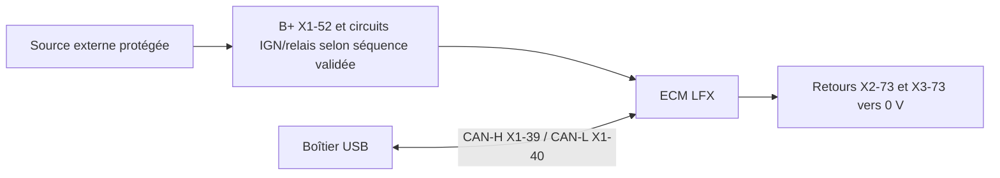

# Camaro 2012 V6 3,6 L LFX — K20 (famille E39 candidate)

**État : brochage véhicule recoupé dans le manuel ; faisceau BENCH et programmation non qualifiés.** Ne pas appliquer ce tableau sans identification physique de l'ECM, référence GM/HW, connecteurs et confirmation du schéma par VIN. Aucun brochage interne MCU supposé. Le tableau indique les fonctions OEM, et non une autorisation de mise sous tension.

| Connecteur | Broche | Signal OEM | Circuit | Couleur |
|---|---:|---|---:|---|
| X1 | 52 | B+ permanent | 440 | rouge/blanc |
| X1 | 51 | IGN Run/Crank | 439 | rose |
| X1 | 73 | IGN alimenté par relais principal | 5290 | rose/noir |
| X1 | 62 | alimentation fusible relais principal 2 | 5291 | rose/noir |
| X1 | 67 | alimentation fusible relais principal 3 | 5292 | rose/noir |
| X1 | 39 | HS GMLAN + | 2500 | beige/noir |
| X1 | 40 | HS GMLAN - | 2501 | beige |
| X2 | 73 | retour masse 451 | 451 | noir/blanc |
| X3 | 73 | retour masse 451 | 451 | noir/blanc |
| X1 | 70 | réveil réseau Accessory Wakeup | 5985 | bleu foncé |
| X1 | 72 | commande bobine relais principal | 5991 | jaune |

X1-72 est une **sortie de commande**, jamais une entrée +12 V. Ne pas alimenter 70 ni réunir les circuits d'IGN/relais sans séquence documentée. Identifier les alimentations nécessaires à la route de banc et leur chronologie à partir du schéma complet ; les circuits 62/67 figurent dans la table connecteur mais leur nécessité sur banc reste à confirmer. X1 connecteur 73 voies, ref faisceau GM 13611938 ; X2 15499466 ; X3 15497996 (vérifier détrompage/révision). Ne pas confondre vue côté fils et côté contacts.

OBD : guide générique. BENCH : schéma de référence ci-dessus ; tension, courant, séquence relais et terminaison à qualifier. BOOT/BAM, BDM/JTAG/Nexus, EEPROM : non qualifiés, aucun point de test ou pin MCU documenté ici. Lecture, écriture et recovery physiques non validés.

## Sources
- https://charm.li/Chevrolet/2012/Camaro%20V6-3.6L/Repair%20and%20Diagnosis/Powertrain%20Management/Diagrams/Electrical%20Diagrams/ — Module Power, Ground, Serial Data and MIL, image https://charm.li/images/DM16Q313/gm173/519809904/
- Table K20 X1 LFX 2012 : https://lemon-manuals.org.ua/Chevrolet/2012/Camaro%20SS%2C%202D%20Coupe%2C%206.2L%20Eng%20VIN%20W/Repair%20and%20Diagnosis%20%28Single%20Page%29/Electrical/Motors%2C%20Switches%2C%20Relays/Wiring%20Systems%20And%20Power%20Management%20-%20Component%20Connector%20End%20Views%20-%20A6C%20Through%20K20%20X2%20%28LSA%29/Component%20Connector%20End%20Views/K20%20Engine%20Control%20Module%20X1%20%28LFX%29/
- Le manuel de connecteurs comporte les sections LFX même sous l'index SS ; le schéma CHARM V6 2012 est la référence véhicule principale.
