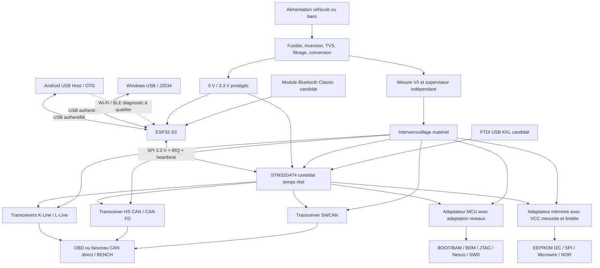

# Architecture matérielle Rev A — avant-projet, non validé

Ce schéma de principe couvre les interfaces ; ce n'est pas un schéma de fabrication ni un brochage ECU. Aucun raccordement automobile ou mémoire avant qualification #2/#3/#5, sécurité #8 et anti-brick #9.

## Liaisons internes candidates (noms de signaux, GPIO physiques à valider)
| Origine | Destination | Signaux | Contraintes |
|---|---|---|---|
| USB-C périphérique | ESP32-S3 | D- GPIO19, D+ GPIO20 | VBUS détection/gestion sans retour d'alimentation ; CC Rd selon USB-C, ESD et routage selon Espressif |
| ESP32-S3 maître | STM32G4 esclave | SCLK, MOSI, MISO, CS, IRQ, heartbeat, GND logique | 3.3 V ; séquences, intégrité, timeouts, session et commandes validées ; aucune clé dans logs |
| STM32 FDCAN1 | TCAN1042V-Q1 | TXD/RXD/STB | VCC 5 V, VIO 3.3 V ; protections bus, autorisation TX matérielle |
| STM32 FDCAN2 | NCV7356 candidat | TXD/RXD/MODE0/MODE1 | vérifier VBAT, pull-up RXD, LOAD et modes selon datasheet ; SWCAN distinct |
| STM32/adaptateur | MCU cible | JTAG/SWD/BDM/BOOT signaux spécifiques | Vref mesurée, buffers tri-state, pinout et timing propres au profil |
| STM32/adaptateur | mémoire externe | SDA/SCL ou SCK/CS/MOSI/MISO ou Microwire | alimentation cible et adaptation de niveaux séparées, protection courant, bus isolé |
| Superviseur | étage alimentation et TX | PGOOD, défaut, mesure V/I, autorisations | sorties inactives au reset ; stratégie de défaut pendant cycle critique qualifiée par cible |

## Alimentation et anti-brick
- USB de développement : carte ESP32-S3 seule, aucun faisceau ECU. En production, séparer alimentation logique et puissance cible ; ne pas alimenter l'ECU depuis VBUS. Prévenir backfeed USB.
- Entrée automobile et banc isolées/commutées selon étude ; protection load dump, inversion, ESD, sous-tension et surintensité ; dimensionnement et mesures à réaliser. Pas de seuil de programmation universel.
- Un seul chemin actif à la fois pour programmation. Interfaces haute impédance au démarrage, reset et défaut ; une perte de lien hôte n'entraîne pas par elle-même une coupure en plein cycle d'écriture. Stratégie locale documentée, énergie et données préchargées, journal durable, recovery qualifié.
- Terminaison CAN commutable uniquement sur banc selon topologie ; ne pas ajouter systématiquement 120 ohms au véhicule. Brochage DLC HS CAN 6/14 et SWCAN 1 à confirmer par véhicule ; aucun brochage BENCH ou puce présumé.
- VCC mémoire 1.8/3.3/5 V uniquement selon référence ; adaptation directionnelle et isolation hôte en circuit ; aucun 12 V sur une puce. Ne pas activer les sorties sans Vref reconnue.
- Les images et trames cible restent conformes au constructeur. Signature du firmware du boîtier uniquement ; authentification native cible si applicable.
- À produire : sélection exacte des MCU/boîtiers, allocation GPIO/AF validée, schéma CAD et revue électrique, BOM sourcée, budget thermique/courant, tests transitoires, défauts et récupération.

## Références candidates
- https://docs.espressif.com/projects/esp-hardware-design-guidelines/en/latest/esp32s3/schematic-checklist.html
- https://www.st.com/en/microcontrollers-microprocessors/stm32g474re.html
- https://www.ti.com/product/TCAN1042V-Q1
- https://www.onsemi.com/download/data-sheet/pdf/ncv7356-d.pdf

## Extension moto et logiciels tiers (#11, #12)
Prévoir USB FTDI réel distinct de CDC, UART/ligne BREAK et timings K/L-Line, module Bluetooth Classic/SPP additionnel si exigé (ESP32-S3 BLE uniquement). Toute voie tierce passe par le contrôle d'accès et le multiplexage local ; aucune liaison brute FTDI directement vers la cible. Prévoir VCI multi-protocole avec modes mutuellement exclusifs, autorisations et surveillance communes. Aucun brochage moto générique, aucun matériel qualifié.
